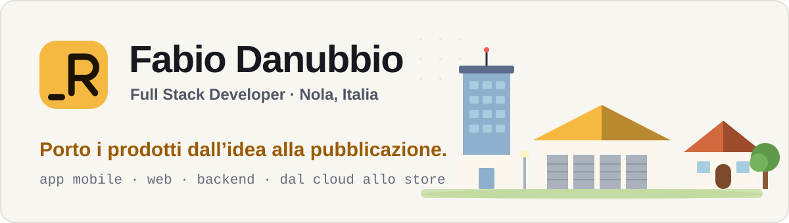

<picture>
  <source media="(prefers-color-scheme: dark)" srcset="docs/assets/banner-dark.svg">
  
</picture>

 

**Sviluppatore full stack di Nola.** Porto i prodotti dall'idea alla pubblicazione: app mobile, web e backend, dal cloud fino allo store.

Full stack developer from Nola, Italy. I take products from idea to release: mobile apps, web and backend, from the cloud to the store.

 

---

## Su cosa lavoro

**Promedya** · dal 2022
Con un team di tre persone sviluppo prodotti verticali per Arca Evolution, il gestionale di Wolters Kluwer: un'API Java *stateful* (Smart Server) che porta fuori dal gestionale la logica del cliente, app Flutter per gli agenti e per la vendita dal furgone, applicazioni Next.js per il magazzino e l'importazione di documenti, servizi NestJS per i solleciti automatici e per la cassa automatica Cashmatic (integrazione certificata).

**Dhonko** · dal 2023
Una piattaforma per organizzare viaggi di gruppo, sviluppata da solo dall'infrastruttura all'app. Nata in Flutter, poi riscritta in un unico codebase TypeScript con Next.js, NestJS e Capacitor. Pagamenti Stripe, prenotazioni di gruppo, chat in tempo reale. In lancio il 12 dicembre 2026.

## Competenze

<picture>
  <source media="(prefers-color-scheme: dark)" srcset="https://skillicons.dev/icons?i=flutter,dart,nextjs,react,ts,nestjs,java,spring,postgres,prisma,redis,docker,firebase,vercel&theme=dark&perline=7">
  
</picture>

| Area | Strumenti |
|---|---|
| **Mobile** | Flutter e Dart (BLoC, MVVM, app offline con sincronizzazione), Capacitor |
| **Web** | Next.js, React, TypeScript |
| **Backend** | NestJS, Java Spring Boot, Node.js, REST, Socket.IO |
| **Dati** | PostgreSQL, SQL Server, MySQL, Prisma, Redis |
| **Integrazioni** | Stripe, Firebase, Cashmatic, API di OpenAI e Anthropic |
| **Sicurezza** | JWT con rotazione dei refresh token, OAuth, SPID/CIE, ruoli e permessi |

Uso anche assistenti AI nello sviluppo: definisco io requisiti e architettura e rivedo il codice che producono.

## Questo repository

È il mio sito, **[danubbio.it](https://www.danubbio.it)**: un piccolo mondo 2D da esplorare, dove ogni edificio è un luogo della mia storia. È fatto con Next.js, SVG e un ciclo di gioco scritto a mano, ed è in italiano e inglese, con tema giorno e notte.

Come è costruito e come si lavora: [`docs/SVILUPPO.md`](docs/SVILUPPO.md). Il mio curriculum in PDF è nella cartella [`cv/`](cv/).

---

Nola (NA) · <a href="https://www.danubbio.it">danubbio.it</a> · <a href="https://www.linkedin.com/in/fabio-danubbio/">LinkedIn</a>

